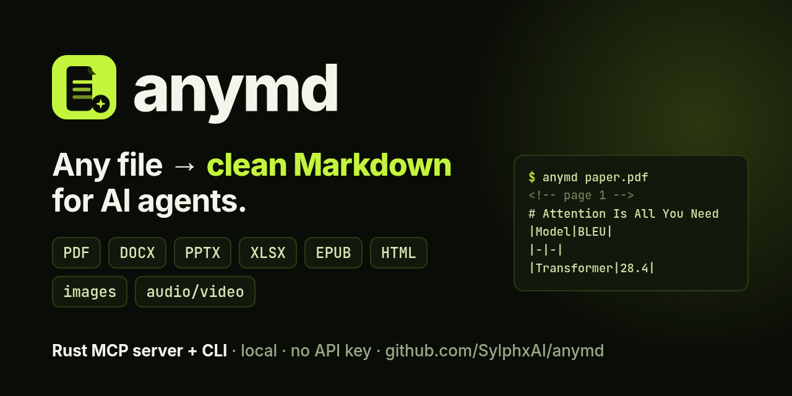

<div align="center">



<h1 hidden>anymd</h1>

<!-- generated:lead -->
PDF, Word, PowerPoint, Excel, EPUB, HTML and web pages, images (OCR), audio and video (metadata, subtitles, transcripts). A fast Rust MCP server and CLI that runs on your machine. No API key.
<!-- /generated:lead -->

<!-- generated:hosted -->
Need verifiable PDF quote checks and video frames? Get [anymd Pro](https://anymd.sylphx.com/pricing?utm_source=github&utm_medium=readme&utm_content=hero_pro) to verify PDF quotes and cite exact video frames offline for US$29 once.
<!-- /generated:hosted -->

[](https://www.npmjs.com/package/@sylphx/anymd)
[](https://www.npmjs.com/package/@sylphx/anymd)
[](https://github.com/SylphxAI/anymd/stargazers)
[](https://registry.modelcontextprotocol.io/v0/servers?search=anymd)
[](https://github.com/SylphxAI/anymd/blob/main/LICENSE)
[](https://glama.ai/mcp/servers/SylphxAI/anymd)
[](https://scorecard.dev/viewer/?uri=github.com/SylphxAI/anymd) <!-- repomap:agent-ready -->[](https://github.com/SylphxAI/repomap#agent-readiness-score)<!-- /repomap:agent-ready -->

[Install](#install) · [Benchmarks](#benchmarks) · [Tools](#mcp-tools) · [CLI](#cli) · [Formats](#formats) · [Docs](https://anymd.sylphx.com/docs?utm_source=github&utm_medium=readme&utm_content=nav) · [Studio](https://anymd.sylphx.com/studio?utm_source=github&utm_medium=readme&utm_content=nav) · [Pro, US$29 once](https://anymd.sylphx.com/pricing?utm_source=github&utm_medium=readme&utm_content=nav)

<!-- generated:formerly -->
<sub>Formerly **pdf-reader-mcp**. [Migrating from pdf-reader-mcp](https://anymd.sylphx.com/docs/migration?utm_source=github&utm_medium=readme&utm_content=formerly)</sub>
<!-- /generated:formerly -->


<sub>A real, unedited terminal recording (asciinema + agg, <a href="https://github.com/SylphxAI/anymd/tree/main/bench/demo">script</a>). The last command is Claude Code answering from the PDF through the anymd MCP server.</sub>

</div>

```bash
npx -y @sylphx/anymd setup                                    # add anymd to every MCP client on this machine
npx -y @sylphx/anymd setup --client cursor,claude-code,codex  # or only the clients you name
npx -y @sylphx/anymd report.pdf > report.md                   # or convert from the shell
```

From [PyPI](https://pypi.org/project/anymd/): `pip install anymd` to install the CLI and Python API, or `uvx anymd` to run the CLI without a separate install.

Also on Homebrew (`brew install sylphxai/tap/anymd`), crates.io (`cargo install anymd`) and Docker (`ghcr.io/sylphxai/anymd`). See [every install option](#install).

<!-- The line below is generated by bench/leaderboard.py from bench/results/*.json. Do not edit it by hand. -->
<!-- proof:start -->

**Head to head on the same 38 documents** (AgentDocBench score · time for all 38 · output tokens):

- [vs Docling](https://anymd.sylphx.com/vs/docling?utm_source=github&utm_medium=readme&utm_content=vs_docling): **96.4** vs 93.0 · **11.5 s** vs 2,432.4 s · **14% fewer tokens**
- [vs Kreuzberg](https://anymd.sylphx.com/vs/kreuzberg?utm_source=github&utm_medium=readme&utm_content=vs_kreuzberg): **96.4** vs 81.7 · **11.5 s** vs 16.0 s · **19% fewer tokens**
- [vs Unstructured](https://anymd.sylphx.com/vs/unstructured?utm_source=github&utm_medium=readme&utm_content=vs_unstructured): **96.4** vs 81.2 · **11.5 s** vs 346.5 s · **11% fewer tokens**
- [vs MarkItDown](https://anymd.sylphx.com/vs/markitdown?utm_source=github&utm_medium=readme&utm_content=vs_markitdown): **96.4** vs 76.8 · **11.5 s** vs 75.6 s · **32% fewer tokens**

<!-- proof:end -->

## Why anymd

<!-- fast:start -->
- **Fast.** Native Rust converts in parallel, page by page. On the 38 benchmark documents, anymd takes **11.5 s** in total; docling 2,432.4 s (212×), markitdown 75.6 s (7×); marker converted 30 of them in 7,104.5 s, against anymd's 4.64 s on the same 30 (1,532×).
<!-- fast:end -->
- **Accurate.** A layout engine rebuilds words from glyph gaps, puts two-column papers in reading order, and recovers tables, including borderless ones. The text stays exactly as printed, with no glued words and no scrambled columns.
- **Lean on tokens.** Pages come back as Markdown with `<!-- page 3 -->` citation anchors, a small front-matter header, and compact tables. A token budget and a cursor keep large documents within your agent's context.
- **Every format, one call.** One tool reads every format listed below. It also accepts web URLs and whole directories, and `search` looks across all of them.
- **Local and private.** Nothing is uploaded. OCR uses installed local doc-VLM models or tesseract; transcripts use ffmpeg and bundled Qwen3-ASR. OCR setup and ASR model downloads require explicit opt-in.
- **Evidence your agent can show (Pro).** [anymd Pro](#anymd-pro) checks a PDF quote against the page and area it cites, and returns the exact video frame behind a claim. US$29, one payment.

## Install

Add anymd to every MCP client on your machine (Claude Code, Codex, Cursor, VS Code, Claude Desktop, Windsurf, Gemini CLI) with one command:

```bash
npx -y @sylphx/anymd setup     # --dry-run to preview, --remove to undo
```

To set up only some clients, name them: `--client cursor,claude-code,codex`. The other ids are `vscode`, `vscode-insiders`, `claude-desktop`, `windsurf` and `gemini`.

Or add it by hand: every MCP client runs the same command, `npx -y @sylphx/anymd`. Node 18+ is the only requirement; npm installs the native binary for your platform.

<details open>
<summary><b>Claude Code</b></summary>

```bash
claude mcp add anymd -- npx -y @sylphx/anymd
```

Or as a plugin, with the anymd skill: `/plugin marketplace add SylphxAI/anymd`, then `/plugin install anymd@anymd`.
</details>

<details>
<summary><b>Codex</b></summary>

```bash
codex mcp add anymd -- npx -y @sylphx/anymd
```

or in `~/.codex/config.toml`:

```toml
[mcp_servers.anymd]
command = "npx"
args = ["-y", "@sylphx/anymd"]
```
</details>

<details>
<summary><b>Cursor</b></summary>

[](https://cursor.com/en/install-mcp?name=anymd&config=eyJjb21tYW5kIjoibnB4IiwiYXJncyI6WyIteSIsIkBzeWxwaHgvYW55bWQiXX0=)

or in `.cursor/mcp.json`:

```json
{ "mcpServers": { "anymd": { "command": "npx", "args": ["-y", "@sylphx/anymd"] } } }
```
</details>

<details>
<summary><b>VS Code</b></summary>

[Install in VS Code](https://insiders.vscode.dev/redirect?url=vscode%3Amcp%2Finstall%3F%257B%2522name%2522%253A%2522anymd%2522%252C%2522command%2522%253A%2522npx%2522%252C%2522args%2522%253A%255B%2522-y%2522%252C%2522%2540sylphx%252Fanymd%2522%255D%257D) with one click, or from a terminal:

```bash
code --add-mcp '{"name":"anymd","command":"npx","args":["-y","@sylphx/anymd"]}'
```

or in `.vscode/mcp.json`:

```json
{ "servers": { "anymd": { "type": "stdio", "command": "npx", "args": ["-y", "@sylphx/anymd"] } } }
```
</details>

<details>
<summary><b>Claude Desktop</b></summary>

One click: download `anymd-<version>.mcpb` from the [latest release](https://github.com/SylphxAI/anymd/releases/latest) and open it. Or, by hand:

Add to `claude_desktop_config.json` (Settings → Developer → Edit Config):

```json
{ "mcpServers": { "anymd": { "command": "npx", "args": ["-y", "@sylphx/anymd"] } } }
```
</details>

<details>
<summary><b>Windsurf, Zed, Cline, and other clients</b></summary>

Any client that speaks MCP over stdio: command `npx`, args `["-y", "@sylphx/anymd"]`. To keep the server inside one folder, add `--allow-dir=/path/to/docs`.
</details>

<details>
<summary><b>CLI only</b></summary>

```bash
npm install -g @sylphx/anymd     # or run it once with: npx -y @sylphx/anymd <file>
```

On Windows, macOS and Linux, you can also install from [PyPI](https://pypi.org/project/anymd/):

```bash
pip install anymd
anymd report.pdf > report.md
# Or run once: uvx anymd report.pdf > report.md
```

On macOS and Linux, Homebrew is also available:

```bash
brew install sylphxai/tap/anymd
```

Docker (amd64 and arm64):

```bash
docker run --rm -v "$PWD:/data" ghcr.io/sylphxai/anymd report.pdf > report.md
docker run -i --rm ghcr.io/sylphxai/anymd        # MCP server on stdio
```

Or build it from [crates.io](https://crates.io/crates/anymd) (Rust 1.95+, CMake and a C++ compiler; doc-VLM OCR and local ASR are included):

```bash
cargo install anymd
```

npm, pip and Docker ship a prebuilt binary, while `cargo install` compiles one on your machine.
</details>

## Benchmarks

[AgentDocBench](https://anymd.sylphx.com/docs/benchmarks?utm_source=github&utm_medium=readme&utm_content=benchmarks) is an open benchmark for document → Markdown conversion for agents: license-clean documents in 12 categories (math papers, two-column papers, financial tables, forms, scans, CJK, slides, spreadsheets, Word, EPUB, HTML), scored on verbatim sentences, text F1, reading order, and table cells, with time and output tokens. Every tool runs on the same kind of GitHub-hosted runner (4 CPUs):

<!-- headline:start -->

| | **anymd** | docling | kreuzberg | unstructured | markitdown | marker | pdftotext |
|---|---|---|---|---|---|---|---|
| Overall score | 96.4 | 93.0 | 81.7 | 81.2 | 76.8 | 71.0 | 42.2 |
| Table cells F1 | 92.2 | 89.9 | 38.4 | 38.4 | 57.2 | 60.9 | 0.0 |
| Reading order | 98.8 | 94.4 | 96.8 | 93.9 | 85.5 | 76.8 | 52.0 |
| Docs converted | 38/38 | 38/38 | 38/38 | 38/38 | 38/38 | 30/38 | 23/38 |
| Time, all docs | 11.5 s | 2,432.4 s | 16.0 s | 346.5 s | 75.6 s | 7,104.5 s | 0.90 s |

<!-- headline:end -->

The generated leaderboard, per-category scores (including where anymd loses), and method are in the [benchmark guide](https://anymd.sylphx.com/docs/benchmarks?utm_source=github&utm_medium=readme&utm_content=benchmarks). [All comparisons](https://anymd.sylphx.com/vs?utm_source=github&utm_medium=readme&utm_content=benchmarks) puts the seven measured tools side by side, and head-to-head pages compare anymd with [Docling](https://anymd.sylphx.com/vs/docling?utm_source=github&utm_medium=readme&utm_content=benchmarks), [Kreuzberg](https://anymd.sylphx.com/vs/kreuzberg?utm_source=github&utm_medium=readme&utm_content=benchmarks), [Marker](https://anymd.sylphx.com/vs/marker?utm_source=github&utm_medium=readme&utm_content=benchmarks), [MarkItDown](https://anymd.sylphx.com/vs/markitdown?utm_source=github&utm_medium=readme&utm_content=benchmarks), [pdftotext](https://anymd.sylphx.com/vs/pdftotext?utm_source=github&utm_medium=readme&utm_content=benchmarks) and [Unstructured](https://anymd.sylphx.com/vs/unstructured?utm_source=github&utm_medium=readme&utm_content=benchmarks). AgentDocBench scores cover only the seven tools in the table, on the 38 documents. Four more pages compare anymd with tools the benchmark has not measured, without a head-to-head score: [LlamaParse](https://anymd.sylphx.com/vs/llamaparse?utm_source=github&utm_medium=readme&utm_content=benchmarks) and [Mistral OCR](https://anymd.sylphx.com/vs/mistral-ocr?utm_source=github&utm_medium=readme&utm_content=benchmarks) are hosted APIs that need an API key and file uploads, where anymd runs locally; [PyMuPDF4LLM](https://anymd.sylphx.com/vs/pymupdf4llm?utm_source=github&utm_medium=readme&utm_content=benchmarks) is an AGPL-3.0 Python library; and [Markdownify MCP](https://anymd.sylphx.com/vs/markdownify-mcp?utm_source=github&utm_medium=readme&utm_content=benchmarks) is a TypeScript MCP server that converts documents with MarkItDown. The corpus, ground truth, adapters, and raw results are in [`bench/`](https://github.com/SylphxAI/anymd/tree/main/bench), and the [Benchmark workflow](https://github.com/SylphxAI/anymd/blob/main/.github/workflows/benchmark.yml) reruns everything; new tools can join with a single adapter file.

### Image and video extraction

[Image and video benchmarks](https://anymd.sylphx.com/docs/benchmarks?utm_source=github&utm_medium=readme&utm_content=benchmarks#image-and-video-extraction)
cover page-image OCR and embedded video subtitles separately:

| Dataset | anymd | Reference alternative |
|---|---|---|
| OmniDocBench v1.6 (1,651 page images), overall ↑ | 21.4 (8.1.0, English tesseract) | TeleOCR 96.91 (author-reported, not our same-run measurement) |
| MP4 mov_text fixtures (4 clips, 12 cues), text/start recall ↑ | 91.7% (8.5.1, 11/12) | FFmpeg 100% (12/12) |
| Matroska SubRip fixtures (4 clips, 12 cues), text/start recall ↑ | 91.7% (8.5.1, 11/12) | FFmpeg 100% (12/12) |

The image score is historical, not a score for the current OCR model. The video
scores were measured on 2026-10-08 using small authored regression datasets, not
films or lectures; anymd drops a repeated caption at a different timestamp.
They measure embedded subtitle extraction, **not visual understanding or ASR**.
The guide links the alternative selection, limitations, timings, raw outputs and
[reproduction harness](https://github.com/SylphxAI/anymd/tree/main/bench/media).

## MCP tools

anymd exposes four tools.

| Tool | Use it to | Key arguments |
|---|---|---|
| **`outline`** | Navigate a heading tree, with node ids and unit/Markdown ranges | `source`, `format` (`json` · `tree`) |
| **`read`** | Turn a file, URL, or folder into Markdown | `source`, `pages` (`"1-5,8"`), `max_tokens` (default 20000), `cursor`, `ocr`, `images` (`refs` · `none`), `revisions` (`markup` · `accept` · `reject`), `transcript`, `download_asr_model` |
| **`search`** | Find text across files, folders, and URLs | `query`, `sources`, `mode` (`auto` · `literal` · `ranked`), `glob`, `max_results` |
| **`inspect`** | Go deeper on a PDF or video | `operation`: `render_page`, `extract_regions`, `ocr_pages`, `structure` (JSON with geometry), `compare`, `inspect`, [`cite_check`](https://anymd.sylphx.com/docs/cite-check?utm_source=github&utm_medium=readme&utm_content=cite_check) (quote and location support) and [`video_timeline`, `render_frame`](https://anymd.sylphx.com/docs/video-timeline?utm_source=github&utm_medium=readme&utm_content=video_timeline) (video evidence), both [anymd Pro](https://anymd.sylphx.com/pricing?utm_source=github&utm_medium=readme&utm_content=tools) |

A `read` answer looks like this:

```markdown
---
source: papers/attention.pdf
title: Attention Is All You Need
pages: 15
showing: pages 1-9
---

<!-- page 1 -->

# Attention Is All You Need
…

<!-- page 8 -->

|Model|BLEU EN-DE|BLEU EN-FR|
|-|-|-|
|Transformer (big)|28.4|41.8|
…

<!-- Stopped at the 20000-token budget. Continue with cursor: "10", or pick pages, or raise max_tokens. -->
```

`search` answers with one line per hit:

```markdown
5 matches for "masked language model" (2 files, 31 sections searched)

### papers/bert.pdf (5)
- p.1: …by using a “**masked language model**” (MLM) pre-training objective, inspired by the Cloze task…
- p.2: …In addition to the **masked language model**, we also use a “next sentence prediction” task…
```

If nothing matches exactly, `search` falls back to BM25-ranked passages, so a question like "how does bidirectional pretraining work" still finds the right page.

## CLI

The same binary is a command-line converter, like MarkItDown but much faster:

```bash
anymd report.pdf > report.md                 # a file
anymd deck.pptx notes.docx budget.xlsx        # several files, each with a header
anymd https://example.com/article            # a web page (main content only)
cat scan.png | anymd - --ocr                 # stdin, with OCR
anymd setup ocr                             # one-time: install the OCR engine and pinned local models (~2 GB)
anymd scan.png --ocr vlm                    # tables as Markdown, formulas as LaTeX
anymd paper.pdf --pages 1-3 --max-tokens 4000
anymd search "indemnification" contracts/ --glob '*.pdf'
anymd doctor                                 # lists the optional tools anymd found
```

Run with no arguments from an MCP client (piped stdin), or as `anymd mcp`, and it serves MCP over stdio.

## Formats

| Input | What you get |
|---|---|
| **PDF** | Reading-order Markdown: headings, paragraphs, lists, tables, sub/superscripts, `<!-- page N -->` markers, bookmarks as an outline. Running headers and page numbers are removed. Image-only pages use local doc-VLM OCR after explicit model setup, otherwise installed tesseract. Embedded figures are saved to the anymd cache and marked in place with their caption (`images: "refs"`, the default). |
| **Word** `.docx` | Headings, bold/italic, links, nested lists, tables with merged cells, footnotes, equations as LaTeX, embedded pictures as image files, tracked changes and comments as CriticMarkup |
| **PowerPoint** `.pptx` | One section per slide in deck order, titles, bullets, tables, chart data, speaker notes, pictures as image files |
| **Excel** `.xlsx .xls .ods` · **CSV/TSV** | One table per sheet, dates as ISO strings, capped at 2,000 rows per sheet |
| **EPUB** | One section per chapter in spine order, plus title and author; pictures as image files |
| **HTML** and **URLs** | The main article only: navigation, cookie banners, and sidebars are dropped. Relative links are resolved, and code keeps its language. |
| **Markdown, text, JSON** | Returned unchanged, with pagination |
| **Images** | Dimensions and EXIF (camera, date, GPS), plus local doc-VLM OCR after model setup, or installed tesseract |
| **Audio / video** | Duration, streams, chapters, embedded and sidecar subtitles (via `ffprobe`/`ffmpeg`). Local Qwen3-ASR transcript with `transcript: true`; `download_asr_model: true` implies a transcript; `transcript: true` alone never downloads weights. |

## How it works

For PDFs, anymd reads glyph positions rather than text runs. Glyphs are grouped into lines by baseline, which tolerates super- and subscripts. Word spaces come from the gaps between glyphs, measured against the font size and adjusted for letter tracking. A column-aware XY cut finds gutters between running text. Tables come from drawn lines where a table has them (a missing line between two cells makes a merged cell) and from aligned columns of whitespace where it does not. Wrapped cell text stays in its cell, stacked header lines become one header, and a header over several columns is kept with each of them. Text a reader cannot see (invisible text, or text in the colour of the box behind it) is left out. Pages are processed in parallel and isolated from each other, so one malformed page never fails the whole document. The other formats are parsed natively in Rust (zip/XML, calamine, html5ever); no Python, LibreOffice, or cloud service is involved.

## anymd Pro

**One-time US$29 purchase. No subscription.** Pro adds two tools for agents that must show where an answer came from. The core stays free and MIT licensed, and nothing that was free has moved to Pro.

- **PDF `cite_check`.** Give it a quote and the page and area your agent cited. It answers whether the quote is there, is not there, or cannot be decided, using the text and its position on the page rather than an AI opinion, and returns the boxes on the page that support a match. [How cite-check works](https://anymd.sylphx.com/docs/cite-check?utm_source=github&utm_medium=readme&utm_content=cite_check)
- **Video timelines and exact frames.** Scene changes, chapters and subtitle or transcript timings for up to 10 minutes per request (`inspect` `video_timeline`, and the `timeline` option of `read` and `outline`). `render_frame` returns the frame behind a citation with the requested time, the actual decoded timestamp and a SHA-256 hash of the image, so anyone can check which moment it shows. [How video timelines work](https://anymd.sylphx.com/docs/video-timeline?utm_source=github&utm_medium=readme&utm_content=video_timeline)

**[Get anymd Pro for US$29 →](https://anymd.sylphx.com/pricing?utm_source=github&utm_medium=readme&utm_content=pro_section)**

Sign in and pay securely in one of 16 currencies (tax included). Then run `anymd login` and use the same account in your browser to activate Pro on this machine. The Pro tools work offline after activation. If you bought Pro before account checkout, use [purchase recovery](https://anymd.sylphx.com/recover). Pro funds anymd's development.

| | anymd | anymd Pro |
|---|---|---|
| Price | Free, MIT | US$29 once (16 currencies, tax included) |
| Runs | On your machine | On your machine, offline after activation |
| You get | `read`, `outline`, `search`, `inspect`, OCR, transcripts, MCP server and CLI | Everything in anymd, plus `cite_check` and video timelines with exact frames |
| Start | `npx -y @sylphx/anymd setup` | [Buy Pro](https://anymd.sylphx.com/pricing?utm_source=github&utm_medium=readme&utm_content=plans), then run `anymd login` |

## Local core and Pro

anymd runs on your machine in both tiers:

- **Local core (free, MIT, this repository).** The `anymd` binary, the MCP server, the CLI and the `anymd-core`, `anymd-pdf` and `anymd-formats` crates. It converts on your machine, uploads nothing, and needs no API key.
- **anymd Pro ([US$29 once](https://anymd.sylphx.com/pricing?utm_source=github&utm_medium=readme&utm_content=hosted), no subscription).** Unlocks deterministic PDF `cite_check` and SHA-256 verifiable video timelines and frame extraction in the same local binary. Sign in to buy, then activate with `anymd login`.

For Rust importers, the `anymd-core`, `anymd-pdf` and `anymd-formats` crate APIs are stable within a major version: no breaking change ships without a major version bump.

## Security

- Local-first: documents never leave your machine unless you pass a URL, and even then only that URL is fetched.
- URL fetches block private and loopback addresses, and every redirect hop is checked again, pinned to its resolved address.
- `--allow-dir=<path>` (repeatable) or `MCP_PDF_ALLOWED_DIRS` confines the server to the directories you list.
- Embedded images are written only to anymd's own cache directory (`ANYMD_CACHE_DIR`, else the platform cache), never next to the source document, and refused over 50 megapixels.
- External tools (tesseract, ffprobe, ffmpeg) are optional. anymd runs them without a shell, with a timeout and an output cap.

See [SECURITY.md](https://github.com/SylphxAI/anymd/blob/main/SECURITY.md) to report a vulnerability.

## Also from Sylphx

Built by [Sylphx](https://sylphx.com).

<!-- generated:also-from -->
- [**Repomap**](https://github.com/SylphxAI/repomap): Local Rust MCP server for mapping a codebase, tracing calls and seeing what a change affects.
- [**Lockdocs**](https://github.com/SylphxAI/lockdocs): Local Rust MCP server for finding library docs that match the versions in your lockfile.
- [**skills**](https://github.com/SylphxAI/skills): Battle-tested agent skills for Claude Code and Codex, installed in one command.
- [**readme-mark**](https://github.com/SylphxAI/readme-mark): Beautiful README images from one URL: banners, badges, icons and stats cards.
- [**Sylphx apps**](https://sylphx.com/apps): Apps and tools from Sylphx.
<!-- /generated:also-from -->

More from Sylphx: https://sylphx.com/open-source

## Star history

[](https://star-history.com/#SylphxAI/anymd&Date)

## License

MIT © [Sylphx](https://sylphx.com)